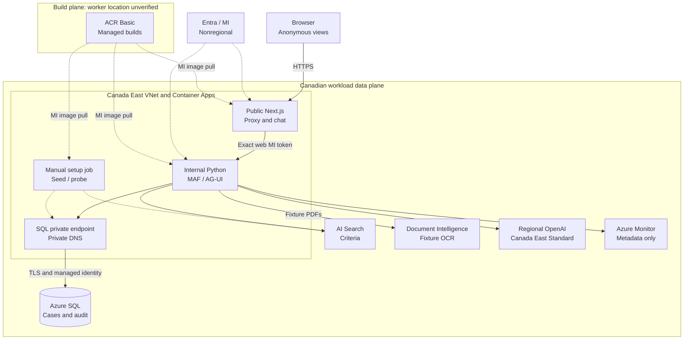

# Benefits IQ

**Better evidence. Human decisions.**

A synthetic benefits-review workspace for the October SE Build. Reviewers check
special-authorization requests, contact-centre teams see safe status updates,
and account managers explore aggregate employer views. Agents prepare and cite;
people explicitly record decisions.

**[Open the live synthetic demo](https://web-biq-benefits-iq-bb2168f95c9d.kindground-2f9b9bf8.canadaeast.azurecontainerapps.io)**
&nbsp;|&nbsp; [Run locally](#run-locally)
&nbsp;|&nbsp; [Deploy to Azure](#deploy-to-azure)
&nbsp;|&nbsp; [Operations guide](docs/operations.md)

> **Public demo, no sign-in.** Anyone can select every enabled demo view and
> perform its synthetic actions. Views are **not authenticated roles**.
> Never enter real personal or health data. Visitors share persistent demo
> records and quotas. This is not a production or healthcare-compliant system.

## What you can explore

| Workspace | Capabilities |
|---|---|
| Clinical reviewer | Queue/filter/sort, Member 360, source documents, intake checks, cited evidence matrix, ownership, priority and team tasks |
| Human decision panel | Approve, decline or request more information with a rationale and explicit confirmation; version checks, idempotency and audit history |
| Contact centre | Operational status, next owner, filtered timeline and permitted follow-up tasks; no clinical fields or reviewer rationale |
| Account manager | Separate employer aggregate snapshots, small-cell suppression and bounded renewal look-ahead; no member-level drill-through |
| Case-bound chat | Read-only status, intake and criteria questions; genuine Python Microsoft Agent Framework (MAF)/AG-UI streaming, cancel and explicit retry |

The seed contains **12 fictional cases across two employers**, including
complete, incomplete, conflicting, stale-criteria and renewal scenarios.
Employer aggregates use a separate, sufficiently large synthetic dataset;
they are not statistics computed from those twelve cases.

### A short demo route

Use **Get to know your dashboard** at the top for a click-to-start guided tour.
It highlights the current view's sections with simple explanations, Back/Next,
Skip and keyboard controls. Reviewer tours open read-only tabs, not workflows;
closing restores the starting tab. No case is changed and no model call is made.
The tour is available in this source/local build; the October 29 public release
predates it and needs a separately approved deployment refresh.

1. Open **Clinical reviewer / Employer A**. Inspect case `SYN-CASE-001` and its
   versioned evidence, or `SYN-CASE-002` for an intake gap.
2. Open **Evidence** to inspect citations. Chat can explain its permitted reads;
   it cannot save evidence, record decisions or send messages.
3. Inspect **Decision** without submitting unless you intend to change the shared
   demo. Recorded synthetic decisions are durable and immutable.
4. Switch to **Contact centre**, then an **Account manager**, to compare the
   intentionally different response shapes. Anyone can switch views.

Public chat, form values and rationales are preset-only. The local demo supports
additional synthetic editing and confirmed **local-only** drafts; neither mode
sends external communications.

## Architecture

The deployed showcase uses Next.js/TypeScript, a separate Python MAF/AG-UI
service and Azure-native synthetic sources. **Only the frontend is public.**



Solid arrows show runtime requests; dashed arrows show identity, setup and
image-distribution relationships. The **Web-to-API edge is a managed-identity
trust boundary**, not a claim that the anonymous view selector authenticates a
person. Python independently validates the exact caller and selected-view scope.
ACR receives only committed, allowlisted source; Fabric/OneLake, employer semantic
models and Purview are **future integrations, not part of this deployment**.
[Editable diagram source](docs/architecture.mmd) |
[SVG export](docs/architecture.svg).

| Component | Placement and purpose |
|---|---|
| Next.js, Python and manual jobs | Canada East Container Apps Consumption; VNet-integrated environment, internal Python ingress |
| SQL and private link | Canada East; authoritative cases/tasks/briefs/decisions/audit, source PDFs and aggregate snapshots; public SQL disabled, Entra-only |
| AI Search Basic | Canada East; versioned, scoped synthetic criteria |
| Document Intelligence S0 | Canada Central; actual PDF extraction with confidence and source evidence |
| Azure OpenAI | Canada East regional **Standard**, `gpt-4.1-mini` version `2025-04-14`; no Global/DataZone fallback |
| ACR, identities and telemetry | Canada East registry and sanitized server logs; Entra identity is nonregional, standard build-worker location is unverified |

SQL itself is a managed service reached through the VNet's private endpoint,
not a database hosted inside the app subnet. Search, OCR and model endpoints
retain managed-identity/key-disabled authorization; **not every service is
private-network-only**. Private DNS is nonregional infrastructure, not a Canadian
data-store guarantee.

## Run locally

**Prerequisites:** Python 3.11+ and Node.js 22+ (tested with Python 3.11 and
Node 24). From the repository root in PowerShell:

```powershell
python -m venv .venv
.\.venv\Scripts\python -m pip install -r requirements.lock.txt
npm ci --no-fund --no-audit
.\.venv\Scripts\python scripts\demo.py
```

Open the ready URL printed by the launcher, normally `http://127.0.0.1:3000`.
No Azure account, model key or uploaded source document is required. The
launcher starts both services on loopback, uses an ephemeral server-only
credential, checks readiness and stops its children on interruption.

**Local is not the public profile:** it uses SQLite and explicitly labelled,
deterministic MAF/AG-UI chat, not cloud inference or OCR. Its signed demo-persona
cookie is not Entra authentication. Do not expose the loopback launcher publicly.
See [local options and development checks](docs/operations.md#local-development).

## Deploy to Azure

The actual entry point is **Python + Azure CLI + staged Bicep**.
There is **no `azd up` configuration or support** in this repository.

### Prerequisites

- Python 3.11+, Git, Azure CLI with Bicep and the `containerapp` extension.
- An interactively signed-in deployer able to create the owned backend API
  registration, Azure resources and required resource-scoped role assignments.
  Visitor sign-in, user app-role assignment and tenant-wide consent are not
  showcase prerequisites; missing deployer rights must still stop setup.
- A verified [Trivy executable](https://github.com/aquasecurity/trivy/releases),
  on `PATH` or selected by the absolute `BENEFITS_TRIVY` path.
- Committed, clean application/build inputs; approval for the paid resources,
  Canadian placement, build-plane exception and private-SQL networking.

The CLI inputs are **subscription GUID** and an environment name of 3-11
lowercase letters/digits/dashes, starting with a letter and ending alphanumerically.
Consecutive dashes are not allowed.
The current templates pin the approved Canadian regions; region is **not a
deployment CLI flag**. Tenant/deployer context and resource IDs are discovered.
No application secret, uploaded document or Fabric capacity is needed.

### Preflight, then deploy

Run from the repository root in PowerShell. Use your own approved subscription
and verified scanner path; the existing deployment uses environment `benefits-iq`.

```powershell
az login
$subscription = "<approved-subscription-guid>"
$environment = "benefits-iq"
$env:BENEFITS_TRIVY = (Resolve-Path "C:\Tools\trivy.exe").Path

# Read-only Azure checks; compiles templates and checks source locally.
python scripts\deploy.py --subscription $subscription --environment $environment

# Paid Azure writes: only after scope approval and validation.
python scripts\deploy.py --subscription $subscription --environment $environment --deploy
```

For Copilot-assisted deployment, follow `azure-prepare` -> `azure-validate` ->
`azure-deploy`; those are agent skills, not shell commands. An existing approved
plan is in [`.azure/deployment-plan.md`](.azure/deployment-plan.md).

The full command creates/wires the owned API audience, identities, registry,
hosting, private SQL topology and data services; builds and scans immutable
images; seeds SQL/Search; and proves MI, private SQL, fresh OCR/Search and real
model streams. It tests private applications **before** public frontend ingress,
then repeats acceptance. `--phase foundation --deploy` stops after the
identity/image proof, before data/app services.

> **Keep `.azure/showcase-<environment>.json`.** It records ownership, resource
> IDs, image digests and receipts. Recover that state for an existing deployment;
> do not delete it or choose a new environment just to bypass a failed stage.
> Reruns intentionally make the frontend private and cause downtime.
> [Rerun, upgrade and cleanup procedures](docs/operations.md#upgrades-recovery-and-cleanup).

### What has actually been verified?

The full same-environment rollout completed on **October 29, 2026 at 18:17:51
UTC**, from runtime source `eb6369a`. Real proofs cover MI issuance/denials,
private SQL access and permissions, seeding, Search, fresh OCR, durable evidence,
and required-read-tool model streams before and after public exposure. Browser
checks cover grounded answers, view shapes, keyboard/mobile use and cancel/retry.
Deployment/browser automation submitted **no clinical decision**.

The recorded Python run had **295 passed / 11 optional local HTTP skips**;
the full npm audit reported **zero known vulnerabilities**. Actual final-image
scan gates passed separately. These are dated observations, not a security or
accessibility certification. Detailed job receipts, digests and recovery history
are in the [deployment evidence](.azure/deployment-plan.md#final-required-tool-deployment-and-browser-acceptance-2026-10-29).

## Safety and limitations

- **Synthetic only, shared state.** Anonymous visitors can change enabled demo
  records and exhaust shared quotas. Contact/employer response shapes are
  constrained, but selecting another view is available to everyone.
- **Humans decide.** Chat is read-only and requires the matching case-bound tool
  for public presets. Evidence checks are not clinical outcomes. Decisions require
  explicit UI confirmation, backend validation and an immutable audited write.
  Model prose is advisory; authoritative case/evidence wins.
- **No open input or external actions.** No uploads, arbitrary URL fetching,
  case creation, freeform public chat/rationale or external sends. Public
  communications are previews; local confirmed drafts remain local-only.
- **Secretless services, not credential-free Azure administration.** Workloads
  use MI/short-lived tokens; no persisted application keys/client secrets.
  Deployer sign-in/token caches are a separate, unavoidable administrative concern.
- **No retained chat.** Closing/changing/reloading clears panel history; no
  transcript/resume endpoint, automatic replay or model-managed conversation
  store. Sanitized events exclude tool arguments/results and state snapshots.
- **Writes are durable.** Version/idempotency checks guard changes; earlier briefs
  and audits survive. Cancellation before a commit can stop work; it cannot undo
  an already committed action. Refresh authoritative state before retrying.

| Public limit | Enforced bound |
|---|---|
| Model runs | 100/day and 5/minute globally; two concurrent runs |
| Workflow writes | 300 POST attempts/day and 30/minute globally |
| Model output | 500 tokens per call; bounded tool loop and seeded inputs |
| Payload/time | 24,000-byte request bodies; 90-second Python / 95-second frontend chat deadlines |

Accepted failures/cancellations consume reservations. SQL-backed global counters
survive restarts; per-view limits are not per-person fairness. Limits and alerts
are **not hard aggregate token or spending caps**.
[Full safeguards and service trust details](docs/operations.md#security-and-runtime-limits).

## Costs and residency

Allow approximately **US$190-US$565/month for light use**, including the approved
**US$35-US$50/month** private-network increment. This is **not a quote or cap**:
retained old-environment charges are additional, and continuously active SQL,
load, storage, Defender, data transfer, taxes and agreements can increase it.
SQL polling can prevent auto-pause; alerts do not cap spending.
[Meter assumptions and breakdown](docs/operations.md#cost-assumptions).

Workload data processing and model inference stay in the approved Canadian
regions. Entra's nonregional identity/control plane is a narrowly accepted
exception. **Migrate the pinned regional model before April 14, 2027**; no
silent Global/DataZone or model fallback is allowed.

**Build-plane exception:** standard ACR managed builds were chosen because no
local builder was available, reducing setup and extra builder cost. Canadian
worker execution is **unverified**, not proven foreign. This exception covers
allowlisted synthetic source/images only, never secrets, real health data or
non-Canadian application processing. Strict build residency needs an approved
local or supported region-pinned builder and separate setup/cost approval.

## Profiles and intentional changes

| Profile | Status |
|---|---|
| Local | Working loopback SQLite workflow and deterministic MAF/AG-UI demo |
| Public showcase | Deployed Azure-native synthetic sources, real regional inference/OCR/Search and private SQL |
| Authenticated Starter | Signed-token/MSAL code and local tests retained; end-user enrollment/bootstrap and live verification are future work |
| Enterprise | Fabric/OneLake, employer semantic models, Purview and customer policies are planned, not deployed integrations or a working profile switch |

| Changed from the guide/initial plan | Why | Tradeoff |
|---|---|---|
| SQL sources and aggregate snapshots instead of mandatory Fabric/semantic models | Reuse durable storage; reduce capacity cost/admin onboarding | No OneLake, DirectLake, DAX or live insurer feed |
| Purview/customer governance deferred to Enterprise | A strictly synthetic demo should not require label/admin discovery | No labels or compliance claim; prerequisites still required for Enterprise |
| Anonymous selectable views instead of end-user sign-in | Demonstrate dashboards without visitor credentials | No verified person or authenticated role isolation |
| Exact MI caller ACL rather than mandatory runtime app-role grants | Supported secretless caller validation without user-role bootstrap | Owned API audience and independent signed-token/caller proof remain required |
| First-party chat instead of CopilotKit/AG-UI JavaScript | Remove affected transitive Zod dependency paths without unsafe cross-major overrides | We maintain accessible chat, protocol validation, cancellation and retries; Python MAF/AG-UI remains genuine |
| Preset inputs and required named read tools | Avoid arbitrary health submissions/open model proxy; ground answers in explicit facts | Less conversational flexibility; model prose is still advisory |
| Pinned regional model and explicit Chat Completions client | Preserve Canadian inference and match the actual installed SDK/API | Legacy-model migration deadline; no managed conversation state |
| Staged CLI/Bicep and standard managed builds | Make proof/scan gates explicit without a separate builder | Orchestrator maintenance, upgrade downtime and disclosed build-location uncertainty |
| New VNet-integrated environment and SQL private endpoint | Respect inherited policy disabling public SQL; old environment cannot be retrofitted | Additional network cost; old resources preserved, no policy exemption |

**CopilotKit can be reintroduced once a compatible patched upstream stack is
available and validated; no release date is promised.** The operational
dashboard did not depend on rebuilding its features. See the
[reinstatement checklist](docs/operations.md#copilotkit-reinstatement).

Enterprise requires separately approved capacity reuse/placement, permissions,
licensing, semantic-model rights and administrator-supplied label/policy
configuration. Discovery failure is not proof that no capacity exists. The
showcase never creates/resumes Fabric capacity, changes shared workspaces or
silently adds consent. [Enterprise prerequisites](docs/operations.md#future-enterprise-and-collaborator-access).

## Find the implementation

| Location | Contents |
|---|---|
| [`app`](app), [`components`](components), [`lib`](lib) | Dashboard, first-party chat, request/stream validation and server proxy |
| [`service`](service) | Python MAF/AG-UI, governed APIs, durable storage and cloud adapters |
| [`agents`](agents), [`skills`](skills) | Six versioned agent definitions and three skill procedures |
| [`infra`](infra), [`scripts`](scripts) | Container images, staged Bicep, seed/bootstrap and local launcher |
| [`tests`](tests) | Workflow, caller isolation, streaming, cloud-contract and browser coverage |
| [Operations guide](docs/operations.md) | Development commands, quotas, identity/build details, upgrades and cleanup |
| [Deployment plan/evidence](.azure/deployment-plan.md) | Approvals, costs, historical blockers, validation and exact live receipts |

Implemented independently from the approved guide. No SignalWeave/unlicensed
source was copied; original uploaded Word/PDF documents remain untouched and
outside the repository and build context.
